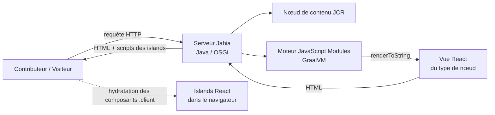
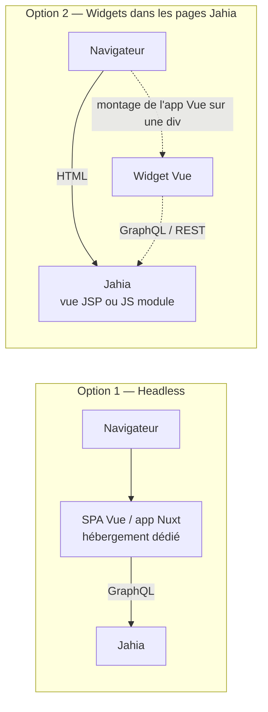

<div class="flex justify-center gap-6 mb-8">
  <IconBox><light-icon icon="atom" size="40px" /></IconBox>
  <IconBox><light-icon icon="triangle" size="40px" /></IconBox>
</div>

<div class="text-6xl font-semibold">Vue.js <span class="text-primary">vs</span> React</div>
<div class="text-2xl opacity-70 mt-4">dans l'écosystème Jahia CMS</div>
<div class="text-base opacity-50 mt-6">Comment chacun fonctionne réellement avec Jahia — et ce que cela implique</div>

---

# <light-icon icon="list" color="#10B5A7" /> Sommaire

1. Jahia en une slide
2. Deux façons d'intégrer un front-end à Jahia
3. React avec Jahia — fonctionnement, avantages, inconvénients
4. Vue.js avec Jahia — fonctionnement, avantages, inconvénients
5. Comparaison côte à côte
6. Lequel choisir, et quand ?

---

# <light-icon icon="server" color="#10B5A7" /> Jahia en une slide

- **DXP Java / OSGi** — contenu stocké dans un dépôt JCR, modules déployés sous forme de bundles OSGi
- **Modèle de contenu** — les types de nœuds (`CND`) définissent les contenus manipulés par les contributeurs
- Le **rendu** est fait *par Jahia*, via des vues associées aux types de nœuds
  - historiquement des vues **JSP**
  - depuis **Jahia 8.2** : les **JavaScript Modules** — des vues écrites en **React (TSX)**
- **API GraphQL** — tout contenu est interrogeable (lecture, écriture, publication)
- Les **outils contributeurs** (jContent, page composer, prévisualisation, workflow de publication) reposent sur le rendu fait par Jahia

<br>

> La vraie question n'est pas *« Vue ou React ? »* mais *« qui fait le rendu de la page : Jahia ou le front-end ? »*

---

# <light-icon icon="sitemap" color="#10B5A7" /> Deux modèles d'intégration

<div class="grid grid-cols-2 gap-8">
<div>

### Intégré (Jahia fait le rendu)

- Le code front-end **s'exécute dans Jahia**
- Les vues sont liées aux types de contenu
- Les contributeurs gardent l'édition en contexte, la prévisualisation, la personnalisation
- Un seul déploiement : le module Jahia

</div>
<div>

### Headless (Jahia = API de contenu)

- Le front-end est une **application séparée** (SPA, Nuxt, Next…)
- Contenu récupéré via **GraphQL**
- Le front-end gère routage, rendu et hébergement
- Deux déploiements : Jahia + l'application

</div>
</div>

<br>

<v-click>

**React** permet les deux — et c'est le **seul** framework supporté pour le modèle intégré.
**Vue** est limité au headless, ou à des widgets côté client dans des pages rendues par Jahia.

</v-click>

---
layout: center-image
---

<IconBox><light-icon icon="atom" size="56px" /></IconBox>

<div class="text-5xl font-semibold mt-6">React <span class="text-primary">avec Jahia</span></div>

---

# <light-icon icon="route" color="#10B5A7" /> React — fonctionnement



- Un **JavaScript Module** est un package npm déployé dans Jahia
- Les vues React sont **rendues côté serveur dans la JVM** par GraalVM (React 19)
- L'interactivité passe par l'**architecture en islands** : seuls les composants `<Island />` envoient du JS au navigateur

---

# <light-icon icon="code" color="#10B5A7" /> React — à quoi ressemble le code

```tsx
// src/components/Hero/default.server.tsx (simplifié)
import { jahiaComponent, Island } from "@jahia/javascript-modules-library";
import LikeButton from "./LikeButton.client";

jahiaComponent(
  {
    nodeType: "mysite:hero",     // lié à un type de contenu Jahia
    componentType: "view",
  },
  ({ title, subtitle }: { title: string; subtitle: string }) => (
    <section>
      <h1>{title}</h1>
      <p>{subtitle}</p>
      {/* rendu côté serveur, hydraté dans le navigateur */}
      <Island component={LikeButton} />
    </section>
  ),
);
```

Les propriétés du nœud arrivent en props — pas d'appel d'API, pas de couche de récupération de données.

---

# <light-icon icon="thumb-up" color="#10B5A7" /> React — avantages

- **Stack officielle et de premier plan** — outillage front-end, docs, starters et support de Jahia
- **Modèle intégré** — vues liées aux types de contenu : les contributeurs gardent **l'édition en contexte, la prévisualisation, le workflow de publication, la personnalisation**
- **SSR par défaut** — HTML rendu dans Jahia, bon SEO et bonnes performances, pas de serveur Node séparé
- **Islands** — du JavaScript uniquement là où l'interactivité est nécessaire
- **Interopérabilité Java** — appel des services Jahia/OSGi depuis le module JS
- **Une seule unité de déploiement** — le module, versionné et déployé comme tout module Jahia
- **Compatible headless aussi** — mêmes compétences réutilisées pour un front Next.js / SPA via GraphQL
- **Même écosystème que l'interface d'admin Jahia** — les extensions d'UI sont aussi en React

---

# <light-icon icon="thumb-down" color="#10B5A7" /> React — inconvénients

- **Lié au runtime de Jahia** — le code tourne sur GraalVM, pas sur Node : tous les packages npm ne fonctionnent pas (pas d'API Node, pas d'API navigateur côté serveur)
- **Conventions propres à Jahia** — `jahiaComponent`, fichiers `.server` / `.client`, règles des islands : une courbe d'apprentissage même pour des devs React
- **Pas de méta-framework React** — pas de fonctionnalités Next.js (routage, data loaders, optimisation d'images) dans le modèle intégré
- **Nécessite Jahia 8.2+** — les plateformes plus anciennes restent sur JSP
- **Cycle de release couplé** — les changements front passent par des modules Jahia ; les devs front ont besoin d'un Jahia local (Docker)
- **Frontière des islands** — les props passées aux islands doivent être sérialisables ; partager un état client entre islands demande du travail en plus

---

# <light-icon icon="ab-testing" color="#10B5A7" /> React — A/B testing avec jExperience

- Tests créés par les **contributeurs** dans Page Composer / jExperience — sans changement de code
- Fonctionne sur tout **contenu droppable** (`jmix:droppableContent`) ou sur une page entière
- Chaque variante est un contenu Jahia, **rendu côté serveur par sa vue React**
  - pas de remplacement côté client, **pas de flicker**
  - pas de code en plus dans les composants
- Tracking injecté par Jahia (`wem.js` + `digitalData`), résultats dans jExperience
- ⚠️ Vérifier la version de jExperience vs Jahia 8.2 ; la personnalisation de page n'est pas encore supportée par le nouveau page builder

<br>

> En Vue headless, les tests A/B doivent être refaits côté client (flicker, tracking à câbler à la main).

---

# <light-icon icon="test-pipe" color="#10B5A7" /> React — QA

- **Tests unitaires** — les vues sont de simples composants React : testables avec Vitest + Testing Library, props mockées
- **End-to-end** — Cypress sur une instance Jahia Docker (helpers `@jahia/cypress`, comme Jahia)
- **QA du contenu** — workspaces EDIT vs LIVE : relecture et prévisualisation avant publication
- **Tester les variantes** — chaque variante A/B et chaque personnalisation est un chemin de rendu à couvrir
- ⚠️ Le code serveur tourne dans GraalVM, pas Node : les e2e sur un vrai Jahia détectent ce que les tests unitaires ratent

---

# <light-icon icon="shield-check" color="#10B5A7" /> React SSR — sécurité des appels d'API côté serveur

<div class="grid grid-cols-2 gap-8 text-sm">
<div>

### Ce qu'apporte le SSR

- Les appels d'API s'exécutent **dans la JVM Jahia**, pendant le rendu — jamais depuis le navigateur
- **Les secrets restent sur le serveur** — clés d'API, tokens, identifiants jamais livrés dans un bundle JS
- **Services internes** accessibles via le réseau privé — pas d'endpoint public, pas de CORS
- **Les droits Jahia s'appliquent** — contenu lu via la session de l'utilisateur courant, ACL respectées
- **Surface d'attaque réduite** — le navigateur reçoit du HTML, pas les réponses brutes des API

</div>
<div>

### Points de vigilance

- **Les props des islands sont publiques** — tout ce qui est passé à un `<Island />` est sérialisé dans le HTML
- **Les fichiers `.client` partent au navigateur** — ne jamais y importer de secrets ni de code serveur
- **Cache HTML** — des données propres à un utilisateur rendues côté serveur peuvent être mises en cache et servies à d'autres : bien régler les règles de cache
- **SSRF** — ne jamais construire d'URL sortante à partir des données de la requête
- **Latence** — une API lente ralentit chaque rendu de page : timeouts et solutions de repli

</div>
</div>

<br>

> Vue headless fait l'inverse : le navigateur appelle l'API, donc les endpoints sont publics et tout token présent dans l'application est visible.

---
layout: center-image
---

<IconBox><light-icon icon="triangle" size="56px" /></IconBox>

<div class="text-5xl font-semibold mt-6">Vue.js <span class="text-primary">avec Jahia</span></div>

---

# <light-icon icon="route" color="#10B5A7" /> Vue.js — fonctionnement

Pas de moteur de rendu Vue officiel dans Jahia : Vue ne peut pas être une vue Jahia. Deux options réalistes :



- **Headless** : Jahia est un dépôt de contenu ; Vue / Nuxt gère routage et rendu
- **Widgets** : Jahia fait le rendu de la page, une app Vue est montée côté client sur un élément réservé

---

# <light-icon icon="code" color="#10B5A7" /> Vue.js — à quoi ressemble le code

```vue
<!-- Headless : récupérer le contenu via l'API GraphQL de Jahia -->
<script setup lang="ts">
const query = `{
  jcr(workspace: LIVE) {
    nodeByPath(path: "/sites/mysite/home/hero") {
      title: property(name: "jcr:title") { value }
      subtitle: property(name: "subtitle") { value }
    }
  }
}`;
const res = await fetch("https://jahia.example.com/modules/graphql", {
  method: "POST", headers: { "Content-Type": "application/json" },
  body: JSON.stringify({ query }),
});
const hero = (await res.json()).data.jcr.nodeByPath;
</script>

<template>
  <section>
    <h1>{{ hero.title.value }}</h1>
    <p>{{ hero.subtitle.value }}</p>
  </section>
</template>
```

Le front-end doit connaître les chemins et types de contenu, et construire la page lui-même.

<style>
.slidev-code, .slidev-code code { font-size: 0.7rem !important; line-height: 1.35 !important; }
</style>

---

# <light-icon icon="thumb-up" color="#10B5A7" /> Vue.js — avantages

- **Tout l'écosystème Vue / Nuxt** — routage Nuxt, SSR/SSG, Pinia, n'importe quel package npm, runtime Node
- **Découplé** — l'équipe front livre indépendamment des releases Jahia
- **Workflow familier** — outillage Vite standard, pas besoin d'un Jahia local pour travailler l'UI (API mockée)
- **Fonctionne avec toute version de Jahia** exposant GraphQL — pas de prérequis 8.2
- **Omnicanal** — la même API de contenu alimente web, mobile, bornes…
- **Courbe d'apprentissage douce** — templates + réactivité, souvent une prise en main plus rapide pour des équipes non React
- **Option widgets** — amélioration progressive de sites JSP existants sans refonte

---

# <light-icon icon="thumb-down" color="#10B5A7" /> Vue.js — inconvénients

- **Aucun support officiel de Jahia** — pas de moteur de rendu Vue, pas de starters, pas de docs ; l'intégration est à votre charge
- **Expérience contributeur dégradée** — édition en contexte, composition de pages, prévisualisation et personnalisation reposent sur le rendu Jahia ; en headless, il faut les reconstruire ou y renoncer
- **La composition de page vit dans le front** — les contributeurs agencent le contenu, mais le code Vue doit associer à la main chaque type de contenu à un composant
- **Deux systèmes à exploiter** — Jahia + un hébergement Node/Nuxt, CORS, authentification, cache, invalidation du cache à la publication
- **Couche de récupération des données** — requêtes GraphQL, typage, états d'erreur et de chargement pour du contenu que Jahia rendrait gratuitement
- **L'option widgets est uniquement côté client** — pas de SSR, le contenu sensible pour le SEO doit rester dans des vues Jahia
- **Décalage avec l'interface de Jahia** — les extensions d'UI d'admin sont en React, une équipe Vue a donc quand même besoin de React

---

# <light-icon icon="table" color="#10B5A7" /> Comparaison côte à côte

<div class="compare-table">

| | **React + Jahia** | **Vue.js + Jahia** |
|---|---|---|
| Support officiel | ✅ De premier plan (JavaScript Modules) | ❌ Aucun (communauté / sur mesure) |
| Qui fait le rendu | Jahia (SSR dans GraalVM) | L'app Vue (headless) ou le navigateur (widgets) |
| Modèle d'intégration | Intégré **et** headless | Headless ou widgets côté client |
| Édition en contexte & prévisualisation | ✅ Native | ⚠️ Perdue ou à reconstruire |
| SEO / SSR | ✅ Intégré | ✅ avec Nuxt / ❌ avec widgets |
| Écosystème npm | ⚠️ Limité côté serveur (pas d'API Node) | ✅ Complet |
| Déploiement | Un module Jahia | Jahia + une app séparée |
| Autonomie du front | ⚠️ Couplée aux releases Jahia | ✅ Indépendante |
| Version minimale de Jahia | 8.2 | Toute version avec GraphQL |
| Extensions de l'UI d'admin | ✅ Même stack | ❌ Toujours React |

</div>

<style>
.compare-table table { font-size: 0.75rem; line-height: 1.2; }
.compare-table th, .compare-table td { padding: 0.3rem 0.6rem; }
</style>

---

# <light-icon icon="directions" color="#10B5A7" /> Lequel choisir, et quand ?

<div class="grid grid-cols-2 gap-8">
<div>

### Choisir **React**

- Les contributeurs sont au cœur du projet : édition en contexte, prévisualisation, personnalisation
- Le site est avant tout un **site web géré par Jahia**
- Vous voulez **une seule plateforme** à exploiter et sécuriser
- Vous êtes (ou passez) sur **Jahia 8.2+**

</div>
<div>

### Choisir **Vue.js**

- L'équipe est **déjà Vue / Nuxt** et l'application est très orientée front
- Jahia est **une source de contenu parmi d'autres** (vrai headless)
- La diffusion **omnicanale** compte plus que l'édition de pages
- Ajout de **widgets interactifs** sur un **site JSP existant**

</div>
</div>

<br>

<v-click>

> **Règle d'or** : si Jahia doit *faire le rendu des pages*, prenez React. Si Jahia doit seulement *servir du contenu*, le framework est au choix — Vue compris.

</v-click>

---
layout: center-image
---

<IconBox><light-icon icon="message-dots" size="48px" /></IconBox>

<div class="text-5xl font-semibold mt-6">Merci</div>
<div class="text-2xl opacity-70 mt-2">Des questions ?</div>

<div class="text-xs opacity-60 mt-8 px-16">

Sources : [Jahia JavaScript Modules](https://academy.jahia.com/documentation/jahia-cms/jahia-8.2/developer/javascript-module-development/about-jahia-javascript-modules) ·
[Architecture en islands](https://academy.jahia.com/documentation/jahia-cms/jahia-8-2/developer/javascript-module-development/island-architecture) ·
[javascript-modules sur GitHub](https://github.com/Jahia/javascript-modules) ·
[Expérience développeur Jahia](https://www.jahia.com/product/developer-experience) ·
[Guide d'intégration d'un design system](https://www.jahia.com/blog/design-system-cms-integration-guide) ·
[Tests A/B jExperience](https://academy.jahia.com/documentation/jexperience/jexperience-2.x-and-3.x/end-user/working-with-your-jexperience-projects/managing-ab-tests-and-personalizations/about-ab-tests-and-personalizations)

</div>
