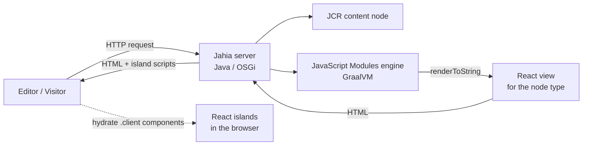
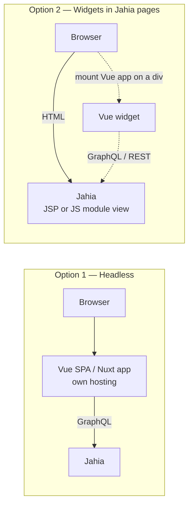

# Vue.js vs React
## in the Jahia CMS ecosystem

How each one actually works with Jahia — and what it costs you

---

# Agenda

1. Jahia in one slide
2. Two ways a front-end meets Jahia
3. React with Jahia — how it works, pros, cons
4. Vue.js with Jahia — how it works, pros, cons
5. Side-by-side comparison
6. Which one, when?

---

# Jahia in one slide

- **Java / OSGi DXP** — content stored in a JCR repository, modules deployed as OSGi bundles
- **Content model** — node types (`CND`) define the content editors manipulate
- **Rendering** is done *by Jahia*, through views attached to node types
  - historically **JSP** views
  - since **Jahia 8.2**: **JavaScript Modules** — views written in **React (TSX)**
- **GraphQL API** — every piece of content is queryable (read, write, publish)
- **Editor tooling** (jContent, page composer, preview, publication workflow) relies on Jahia doing the rendering

<br>

> The key question is not *"Vue or React?"* but *"who renders the page: Jahia or the front-end?"*

---

# Two integration models

<div class="grid grid-cols-2 gap-8">
<div>

### Embedded (Jahia renders)

- Front-end code **runs inside Jahia**
- Views are bound to content types
- Editors keep in-context editing, preview, personalization
- One deployment: the Jahia module

</div>
<div>

### Headless (Jahia = content API)

- Front-end is a **separate app** (SPA, Nuxt, Next…)
- Content pulled through **GraphQL**
- Front-end owns routing, rendering, hosting
- Two deployments: Jahia + the app

</div>
</div>

<br>

<v-click>

**React** can do both — and is the **only** framework supported for the embedded model.
**Vue** is limited to headless, or to client-side widgets inside Jahia-rendered pages.

</v-click>

---
layout: section
---

# React with Jahia

---

# React — how it works



- A **JavaScript Module** is an npm package deployed into Jahia
- React views are **server-side rendered inside the JVM** by GraalVM (React 19)
- Interactivity through the **Island architecture**: only `<Island />` components ship JS to the browser

---

# React — what the code looks like

```tsx
// src/components/Hero/default.server.tsx (simplified)
import { jahiaComponent, Island } from "@jahia/javascript-modules-library";
import LikeButton from "./LikeButton.client";

jahiaComponent(
  {
    nodeType: "mysite:hero",     // bound to a Jahia content type
    componentType: "view",
  },
  ({ title, subtitle }: { title: string; subtitle: string }) => (
    <section>
      <h1>{title}</h1>
      <p>{subtitle}</p>
      {/* SSR'd on the server, hydrated in the browser */}
      <Island component={LikeButton} />
    </section>
  ),
);
```

Node properties arrive as props — no API call, no fetching layer.

---

# React — pros

- **Official, first-class stack** — Jahia's own front-end tooling, docs, starters and support
- **Embedded model** — views bound to content types: editors keep **in-context editing, preview, publication workflow, personalization**
- **SSR by default** — HTML rendered in Jahia, good SEO and performance, no separate Node server
- **Islands** — JavaScript only where interactivity is needed
- **Java interop** — call Jahia/OSGi services from the JS module
- **One deployment unit** — the module, versioned and deployed like any Jahia module
- **Also fits headless** — same skills reused for a Next.js / SPA front-end over GraphQL
- **Same ecosystem as Jahia's admin UI** — UI extensions are React too

---

# React — cons

- **Tied to Jahia's runtime** — code runs on GraalVM, not Node: not every npm package works (no Node APIs, no browser APIs on the server)
- **Jahia-specific conventions** — `jahiaComponent`, `.server` / `.client` files, Island rules: a learning curve even for React developers
- **No React meta-framework** — no Next.js features (routing, data loaders, image optimization) in the embedded model
- **Requires Jahia 8.2+** — older platforms stay on JSP
- **Coupled release cycle** — front-end changes deploy through Jahia modules; front-end devs need a local Jahia (Docker)
- **Island boundary** — props passed to islands must be serializable; shared client state across islands needs extra work

---
layout: section
---

# Vue.js with Jahia

---

# Vue.js — how it works

No official Vue renderer in Jahia: Vue can't be a Jahia view. Two realistic options:



- **Headless**: Jahia is a content repository; Vue / Nuxt owns routing and rendering
- **Widgets**: Jahia renders the page, a Vue app is mounted client-side on a placeholder element

---

# Vue.js — what the code looks like

```vue
<!-- Headless: fetch content from Jahia's GraphQL API -->
<script setup lang="ts">
const query = `
  query {
    jcr(workspace: LIVE) {
      nodeByPath(path: "/sites/mysite/home/hero") {
        title: property(name: "jcr:title") { value }
        subtitle: property(name: "subtitle") { value }
      }
    }
  }`;

const res = await fetch("https://jahia.example.com/modules/graphql", {
  method: "POST",
  headers: { "Content-Type": "application/json" },
  body: JSON.stringify({ query }),
});
const hero = (await res.json()).data.jcr.nodeByPath;
</script>

<template>
  <section>
    <h1>{{ hero.title.value }}</h1>
    <p>{{ hero.subtitle.value }}</p>
  </section>
</template>
```

The front-end must know content paths/types and build the page itself.

---

# Vue.js — pros

- **Full Vue / Nuxt ecosystem** — Nuxt routing, SSR/SSG, Pinia, any npm package, Node runtime
- **Decoupled** — front-end team ships independently of Jahia releases
- **Familiar workflow** — standard Vite tooling, no local Jahia required to work on UI (mock the API)
- **Works with any Jahia version** exposing GraphQL — no 8.2 requirement
- **Omnichannel** — the same content API feeds web, mobile, kiosks…
- **Gentle learning curve** — templates + reactivity, often faster onboarding for non-React teams
- **Widgets option** — progressive enhancement of existing JSP sites without a rewrite

---

# Vue.js — cons

- **No official Jahia support** — no Vue renderer, no starters, no docs; you own the integration
- **Editor experience degrades** — in-context editing, page composition, preview and personalization are built around Jahia rendering; headless means rebuilding or giving them up
- **Page composition lives in the front-end** — editors arrange content, but Vue code must map every content type to a component by hand
- **Two systems to run** — Jahia + a Node/Nuxt hosting, CORS, auth, caching, cache invalidation on publish
- **Data fetching layer** — GraphQL queries, typing, error and loading states for content Jahia would render for free
- **Widgets option is client-side only** — no SSR, SEO-sensitive content must stay in Jahia views
- **Mismatch with Jahia's own UI** — admin UI extensions are React, so a Vue team still needs React there

---

# Side-by-side

| | **React + Jahia** | **Vue.js + Jahia** |
|---|---|---|
| Official support | ✅ First-class (JavaScript Modules) | ❌ None (community / custom) |
| Who renders | Jahia (SSR in GraalVM) | Vue app (headless) or browser (widgets) |
| Integration model | Embedded **and** headless | Headless or client-side widgets |
| In-context editing & preview | ✅ Native | ⚠️ Lost or rebuilt |
| SEO / SSR | ✅ Built in | ✅ with Nuxt / ❌ with widgets |
| npm ecosystem | ⚠️ Limited on server (no Node APIs) | ✅ Full |
| Deployment | One Jahia module | Jahia + separate app |
| Front-end autonomy | ⚠️ Coupled to Jahia releases | ✅ Independent |
| Minimum Jahia version | 8.2 | Any with GraphQL |
| Admin UI extensions | ✅ Same stack | ❌ Still React |

---

# Which one, when?

<div class="grid grid-cols-2 gap-8">
<div>

### Choose **React**

- Editors are central: in-context editing, previews, personalization
- Site is primarily a **Jahia-managed website**
- You want **one platform** to run and secure
- You're on (or moving to) **Jahia 8.2+**

</div>
<div>

### Choose **Vue.js**

- Team is **already Vue / Nuxt** and the app is front-end heavy
- Jahia is **one content source among others** (true headless)
- **Omnichannel** delivery matters more than page editing
- Enhancing an **existing JSP site** with interactive widgets

</div>
</div>

<br>

<v-click>

> **Rule of thumb**: if Jahia should *render pages*, use React. If Jahia should only *serve content*, the framework is your choice — Vue included.

</v-click>

---
layout: center
class: text-center
---

# Thank you

Questions?

<div class="text-sm opacity-70 mt-8">

Sources: [Jahia JavaScript Modules](https://academy.jahia.com/documentation/jahia-cms/jahia-8.2/developer/javascript-module-development/about-jahia-javascript-modules) ·
[Island architecture](https://academy.jahia.com/documentation/jahia-cms/jahia-8-2/developer/javascript-module-development/island-architecture) ·
[javascript-modules on GitHub](https://github.com/Jahia/javascript-modules) ·
[Jahia developer experience](https://www.jahia.com/product/developer-experience) ·
[Design system integration guide](https://www.jahia.com/blog/design-system-cms-integration-guide)

</div>
